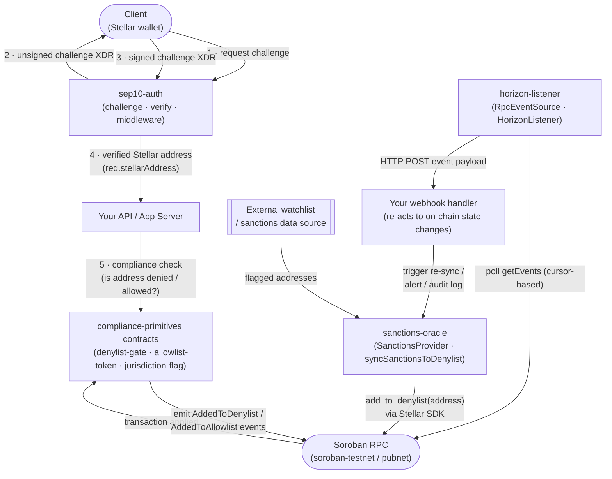

# compliance-adapters

[](https://github.com/stellar-compliance-kit/compliance-adapters/actions/workflows/ci.yml)
[](https://scorecard.dev/viewer/?uri=github.com/stellar-compliance-kit/compliance-adapters)

Integration adapters connecting Stellar compliance primitives to SEP-10 auth, sanctions oracles, and Horizon/RPC event streams.

Having on-chain compliance controls — allowlists, denylists, jurisdiction flags — is only half the problem. To actually run a compliant app on Stellar, teams still need to verify who's making a request, feed real-world watchlist data into those on-chain controls, and react when compliance state changes. That's a lot of repetitive off-chain glue: SEP-10 authentication, syncing external sanctions data, listening for contract events. This repo provides ready-made, well-tested adapters for that glue layer so app developers don't have to hand-roll it for every project.

## Relationship to `compliance-primitives`

This repo consumes the on-chain Soroban contracts defined in
[`compliance-primitives`](https://github.com/stellar-compliance-kit/compliance-primitives) —
`allowlist-token`, `denylist-gate`, and `jurisdiction-flag`. It does not vendor or reimplement
those contracts; adapters here call into deployed instances of them (or listen for events they
emit) via `@stellar/stellar-sdk`. If you're looking for the on-chain contract logic itself, that
lives in the other repo.

## What's in this repo

This is a monorepo with three independent packages and a runnable examples directory:

- **[`sep10-auth`](./sep10-auth)** — builds and verifies [SEP-10](https://stellar.org/protocol/sep-10)
  web authentication challenges, so you can confirm a request is really coming from the Stellar
  address it claims to be from before running any compliance check. Includes an example Express
  middleware.
- **[`sanctions-oracle`](./sanctions-oracle)** — a `SanctionsProvider` interface plus a mock
  implementation and a sync script that pushes flagged addresses into a deployed `denylist-gate`
  contract instance.
- **[`horizon-listener`](./horizon-listener)** — an example service that polls Soroban RPC for
  `denylist-gate` / `allowlist-token` contract events and re-emits them to a webhook, as a
  reference pattern for reacting to on-chain compliance state changes.

Each package has its own `README.md`, tests, and `package.json`.

## Rate limiting behind a proxy (`sep10-auth`)

The `sep10-auth` rate limiter's default key generator uses `req.ip` to identify clients. If your
app runs behind a load balancer, reverse proxy, or CDN and you have **not** configured Express to
trust that proxy, `req.ip` will be the proxy's address for every request. The result: all clients
share a single IP and get rate limited together, so one busy client can lock everyone else out.

You must tell Express which proxies to trust so `req.ip` reflects the real client address.

### Express

```ts
import express from 'express';

const app = express();

// Trust the first hop (e.g. a single load balancer / reverse proxy in front of the app).
// Use a specific IP/CIDR list or a hop count that matches your deployment topology.
app.set('trust proxy', 1);

// ...register the sep10-auth middleware as usual
```

Set `trust proxy` to the number of proxy hops in front of your app, or to an explicit list of
trusted proxy addresses/subnets (e.g. `app.set('trust proxy', '10.0.0.0/8')`). Avoid
`app.set('trust proxy', true)` in production unless every request is guaranteed to pass through a
trusted proxy — otherwise clients can spoof `X-Forwarded-For` and evade the limiter.

### Fastify

Fastify does not use Express's `trust proxy` setting; configure `trustProxy` on the Fastify
instance instead:

```ts
import Fastify from 'fastify';

const app = Fastify({
  // Trust the first hop, or pass an explicit list of trusted proxy addresses/subnets.
  trustProxy: 1,
});

// ...register the sep10-auth middleware as usual
```

As with Express, prefer a hop count or explicit proxy list over `trustProxy: true` so clients
cannot spoof `X-Forwarded-For` to bypass the rate limiter.

## Examples

Runnable examples live under [`examples/`](./examples). Each is a self-contained npm workspace
that wires the adapters together in a realistic scenario.

### [`examples/sep10-browser-login`](./examples/sep10-browser-login)

A Vite + vanilla TypeScript single-page app that demonstrates the **client-side**
SEP-10 flow using the [Freighter](https://www.freighter.app/) browser wallet:

1. Connect Freighter and obtain the user's Stellar public key.
2. `GET /auth?account=<G…>` — fetch an unsigned challenge XDR from the example server.
3. Sign the XDR in-browser via Freighter's `signTransaction()` API.
4. `POST /auth { transaction }` — submit the signed XDR; receive a JWT.
5. Store the JWT in `sessionStorage` and display it for use as a Bearer token.

Runs against the `full-stack-demo` server (or any SEP-10-compliant API) via a
Vite dev-server proxy. No CORS configuration required during development.

### [`examples/sep10-sanctions-gate`](./examples/sep10-sanctions-gate)

An Express server exposing a single gated route (`GET /gated`) that composes `sep10-auth` and
`sanctions-oracle` end-to-end:

1. `createSep10Middleware` from `sep10-auth` validates the caller's SEP-10 Bearer token and
   attaches the verified Stellar address to `req.stellarAddress`. Unauthenticated requests get
   a 401 before the sanctions check ever runs.
2. The verified address is checked against a `SanctionsProvider`. A flagged address gets a 403;
   a clean address gets a 200 with the verified address echoed back.

To run it locally (requires a real `SERVER_ACCOUNT_ID` env var pointing to a Stellar G... key):

```bash
npm install --workspace=sep10-sanctions-gate
SERVER_ACCOUNT_ID=G... HOME_DOMAIN=localhost:3000 npm run dev --workspace=sep10-sanctions-gate
```

To run its tests:

```bash
npm test --workspace=sep10-sanctions-gate
```

## Architecture

The diagram below shows how the three packages fit together in a typical deployment alongside the on-chain contracts from [`compliance-primitives`](https://github.com/stellar-compliance-kit/compliance-primitives).



**Flow summary:**

1. `sep10-auth` authenticates the caller's Stellar address before any compliance check runs.
2. Your app server queries the on-chain `denylist-gate` / `allowlist-token` / `jurisdiction-flag` contracts to decide whether the authenticated address is permitted.
3. `sanctions-oracle` periodically pulls flagged addresses from an external watchlist and pushes them into `denylist-gate` via Soroban RPC.
4. `horizon-listener` polls Soroban RPC for contract events (e.g. `AddedToDenylist`) and forwards them to a webhook, allowing downstream services to react to on-chain state changes in near-real-time — for example by triggering a fresh `sanctions-oracle` sync.

## Quick start

Requires Node 20+.

```bash
git clone https://github.com/stellar-compliance-kit/compliance-adapters.git
cd compliance-adapters
npm install

# run every package's test suite
npm test

# run a single package's tests
npm test --workspace=sep10-auth

# build all packages
npm run build

# build a single package
npm run build --workspace=sep10-auth
```

### Using the CLI

The published `compliance-adapters` CLI provides command-line tools for managing compliance data. For example, to sync sanctions data to a contract in dry-run mode:

```bash
npx compliance-adapters sync-sanctions --dry-run --addresses ./sanctions-oracle/test/fixtures/addresses.json
```

Run `npx compliance-adapters --help` for available commands and `npx compliance-adapters sync-sanctions --help` for command-specific options.

To run sync on a schedule, see [`docs/deploy/`](./docs/deploy/README.md) for a Kubernetes CronJob and a systemd service + timer.

### Building

The root-level `npm run build` script runs the TypeScript compiler across all three packages
(`sep10-auth`, `sanctions-oracle`, and `horizon-listener`) using npm workspaces. Each package
produces compiled output in its `dist/` directory. This is equivalent to running `tsc -p .` in
each package independently.

### Working with a single package

If you only need to work on 

/* … truncated 4134 chars — edit only what you need near the top … */
